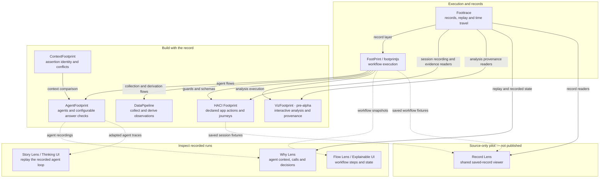

### The flowchart pattern for software — systems that explain themselves.

**→ [footprintjs.github.io](https://footprintjs.github.io/)**

A flowchart is how a person draws a system: a box for each step, an arrow for what
happens next. footprintjs makes your code *be* that flowchart — so the thing that
runs is the thing you inspect. Configured recorders capture its execution path,
data activity and decisions as they happen.

One pattern, from backend flows and data pipelines to agents, app interactions
and interactive analysis. **Foottrace owns the execution-record layer; FootPrint
owns the engine.** The libraries below build on those foundations or present the
records they produce.

---

## The ecosystem — as its own flowchart

Solid arrows show selected runtime building blocks; dotted arrows show recorded
inputs supplied to a view. This is not an exhaustive dependency map. Each viewer
has its own input contract and supported package versions; these are not all
interchangeable record formats.

HCI's session recorder uses Foottrace directly, without executing a FootPrint
flowchart; its newer action ledger remains separate. Viz reads Foottrace analysis
evidence, while its interaction history and replay use Viz's own record format.
The [Record Lens pilot](https://github.com/footprintjs/explainable-ui/blob/main/pilots/record-lens/README.md)
reads saved workflow and HCI records without either producer installed. It has no
published entry point yet. Replaying recorded steps and state does not require an
authored flowchart; drawing the complete workflow, including untaken branches,
requires that structure to be saved separately.

| Project | Role | Links |
|---|---|---|
| **Foottrace** | execution records, replay, time travel and evidence queries, independent of the producing engine | [repo and docs](https://github.com/footprintjs/foottrace) · [npm](https://www.npmjs.com/package/foottrace) |
| **FootPrint** (`footprintjs`) | named stages, tracked state and recorded decisions for backend workflows | [home](https://footprintjs.github.io/footPrint/) · [repo](https://github.com/footprintjs/footPrint) · [npm](https://www.npmjs.com/package/footprintjs) |
| **AgentFootprint** | agent orchestration, execution provenance and configurable checks before answer delivery | [home and docs](https://agentfootprint.dev/) · [repo](https://github.com/footprintjs/agentfootprint) · [npm](https://www.npmjs.com/package/agentfootprint) |
| **ContextFootprint** | compare host-supplied assertions by identity and find conflicts; does not decide which assertion is true | [repo and docs](https://github.com/footprintjs/contextfootprint) · [npm](https://www.npmjs.com/package/contextfootprint) |
| **DataPipeline** (`footprintjs-datapipeline`) | collect observations, derive new ones and retain their evidence through FootPrint flows | [published package and README](https://www.npmjs.com/package/footprintjs-datapipeline) |
| **HACI Footprint** (`hcifootprint`) | expose declared app actions and journeys for people and agents | [home and docs](https://footprintjs.github.io/hcifootprint/) · [repo](https://github.com/footprintjs/hcifootprint) · [npm](https://www.npmjs.com/package/hcifootprint) |
| **VizFootprint** | interactive visualization and analysis with selection provenance; **pre-alpha, source checkout** | [repo and docs](https://github.com/footprintjs/vizfootprint) |
| **Flow Lens / Explainable UI** | inspect a workflow's recorded steps and state | [demo](https://footprintjs.github.io/explainable-ui/) · [repo](https://github.com/footprintjs/explainable-ui) · [npm](https://www.npmjs.com/package/footprint-explainable-ui) |
| **Why Lens** (`agentfootprint-lens`) | inspect an agent's recorded context, tool calls, decisions and cost | [repo and docs](https://github.com/footprintjs/agentfootprint-lens) · [npm](https://www.npmjs.com/package/agentfootprint-lens) |
| **Story Lens / Thinking UI** | replay an adapted agent trace as a scrubbable story | [demo](https://footprintjs.github.io/agentThinkingUI/) · [repo](https://github.com/footprintjs/agentThinkingUI) · [npm](https://www.npmjs.com/package/agentthinkingui) |

For a combined agent-recording screen, [footprint-viewer](https://github.com/footprintjs/footprint-viewer)
wires the lenses to one cursor. Its published `0.1.0` peer range targets
AgentFootprint `^9.48.0`; it is not the current AgentFootprint 11 viewer recommendation.

Examples of the wider ecosystem include the
[AssessmentFootprint workbench](https://github.com/footprintjs/assessmentfootprint),
[agent samples](https://github.com/footprintjs/agent-samples), and
[VizFootprint demos](https://github.com/footprintjs/vizfootprint-demos).

---

## Principles

1. **Collect during execution.** Record tracked reads, writes and decisions while the workflow runs.
2. **Keep the record and its limits.** Foottrace readers query retained evidence; missing or withheld evidence stays a gap.
3. **Choose the view for the record.** Use the appropriate adapter and compatible versions to inspect workflow steps, agent decisions or the recorded story.

> A record is evidence of observed execution, not proof that an external fact or an answer is true.

---

## Built for agents

The hardest question in an agentic system is *what supports this answer?* — which
context was supplied, which tools ran, what they returned and which checks passed.
**AgentFootprint** connects those recorded events and provides configurable answer
checks. The app still owns its evidence rules and delivery policy. These records
do not reveal a model's private reasoning or make every answer verified.

---

open source · [MIT](https://github.com/footprintjs/footPrint/blob/main/LICENSE) · © 2024–present [Sanjay Krishna Anbalagan](https://github.com/sanjay1909)
